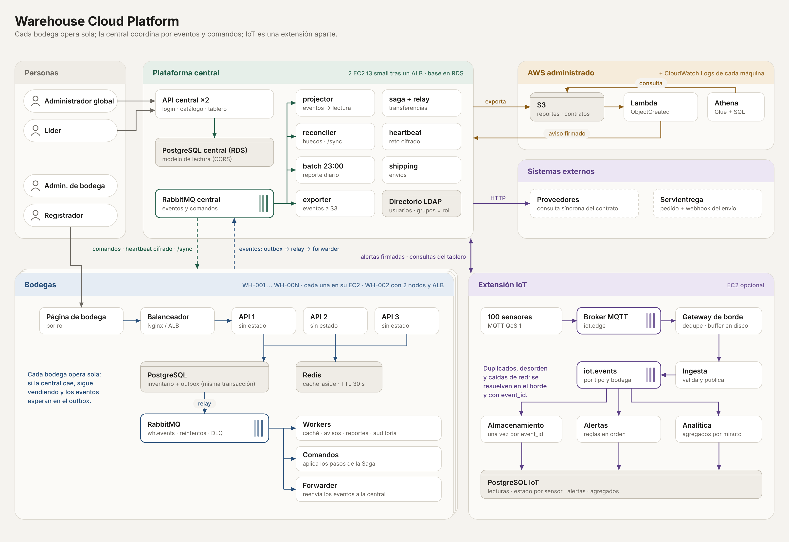
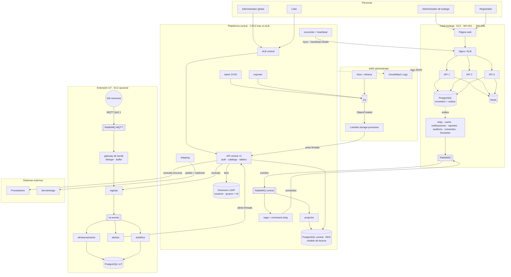

# Arquitectura final

## Diagrama



Versión en Mermaid (se puede editar y GitHub la dibuja):



Versión en texto, con la misma forma que la arquitectura de referencia:

```text
                                   INTERNET
                                      |
                 +--------------------+--------------------+
                 |                                         |
              ALB central                                  ALB / Nginx de cada bodega
                 |                                         |
         API central x2 (EC2) --bind--> LDAP      +--------+--------+
                 |                                |        |        |
     +-----------+-----------+                  API 1    API 2    API 3   (sin estado)
     |           |           |                    |        |        |
 Read Model   RabbitMQ    Workers                 +--------+--------+
 PostgreSQL   central     projector, saga,                 |
 (RDS)           ^        reconciler, batch,               |
     |           |        shipping, exporter               |
     |           |                               PostgreSQL + Redis + RabbitMQ (por bodega)
     |           +---------- eventos (outbox + forwarder) -+
     |           +---------- comandos de la Saga --------->+
     |
     +--> S3 (Batch, exportaciones, contratos) --ObjectCreated--> Lambda --aviso--> central
     +--> Athena (Glue sobre S3)
     +--> IoT: sensores -> MQTT -> gateway -> ingesta -> RabbitMQ -> almacenamiento / alertas / analítica

Logs JSON de cada máquina -> CloudWatch Logs (AWS) · /metrics/prometheus -> Prometheus + Grafana (local)
```

## Componentes

| Componente | Responsabilidad | Escala | Si falla |
|---|---|---|---|
| API de bodega (×3) | Productos, inventario, movimientos, solicitudes, reportes | Más instancias tras el balanceador | Las otras instancias atienden |
| PostgreSQL de bodega | Fuente de verdad del inventario y outbox | Vertical o nodos de API extra | La bodega responde 503 |
| Redis de bodega | Caché del saldo | Memoria | Lecturas desde PostgreSQL |
| RabbitMQ de bodega | Efectos secundarios y reenvío a la central | Colas por responsabilidad | Eventos esperan en el outbox |
| Workers de bodega | Caché, alertas, reportes, auditoría, comandos, reenvío | Réplicas por cola | Mensajes esperan en su cola |
| API central (×2 en AWS) | Login, catálogo universal, tablero, transferencias, contratos | Instancias tras su ALB | El otro nodo atiende; las bodegas siguen operando |
| Base central (RDS) | Usuarios, claves de firma, Saga, contratos y modelo de lectura | Clase de instancia, réplicas de lectura | API central 503; las bodegas siguen y la central se pone al día |
| Directorio LDAP | Contraseñas y grupos (el grupo define el rol) | Réplicas de OpenLDAP o el AD corporativo | Inicio de sesión 503; los tokens emitidos siguen valiendo |
| Modelo de lectura | Consultas globales (CQRS) | Réplicas de lectura | Se reconstruye desde las bodegas |
| Saga | Transferencias entre bodegas | Una instancia por partición de transferencias | Comandos esperan en el outbox central |
| Batch | Reporte diario y auditoría a S3 | Una ejecución por día | Reintento y ejecución manual |
| Lambda | Validación de contratos y del reporte | Administrado por AWS | Reintento de AWS y respaldo en S3 |
| IoT | Telemetría de sensores y alertas | Gateway por sitio, workers por cola | Buffer en el gateway |

## Cómo se cumplen los principios de la arquitectura de referencia

| Principio | Dónde |
|---|---|
| 1. Cada bodega es autónoma | Stack propio; tokens verificados localmente; outbox local (ADR-003, ADR-008) |
| 2. La central consolida | Modelo de lectura alimentado por eventos; no ejecuta operaciones de inventario (ADR-006) |
| 3. Los eventos desacoplan | Outbox + RabbitMQ + workers (ADR-002) |
| 4. Redis acelera lecturas | Cache-Aside con invalidación; nunca es la fuente de verdad (ADR-001) |
| 5. PostgreSQL mantiene las transacciones | Bloqueo de fila, saldo nunca negativo, movimiento y evento en la misma transacción |
| 6. RabbitMQ introduce problemas nuevos | Duplicados (`event_id`), reintentos con TTL, orden por secuencia, DLQ (ADR-014) |
| 7. El modelo de lectura acepta consistencia eventual | Frescura visible por bodega; reconciliación por huecos |
| 8. Saga coordina transferencias | Orquestada por la central con compensaciones (ADR-005) |
| 9. Observabilidad transversal | Correlation ID, logs JSON (CloudWatch en AWS), `/metrics/prometheus` en cada servicio, Grafana en local (ADR-015) |
| 10. IoT es una extensión | Stack separado que la central consulta si está disponible (ADR-016) |

## Dominios y datos

| Dominio | Dueño de los datos | Tablas principales |
|---|---|---|
| Inventario de una bodega | Cada bodega | `products`, `inventory`, `inventory_lots`, `inventory_movements`, `outbox_events`, `inventory_alerts`, `operation_requests`, `universal_products` (copia) |
| Usuarios | Directorio LDAP | `ou=usuarios` (contraseña `{SSHA}`), `ou=grupos` (`Lideres`, `Administradores-WH-001`, ...) |
| Plataforma | Central | `warehouses`, `users` (perfil y estado), `signing_keys`, `universal_products`, `product_requests`, `notifications`, `contracts`, `batch_runs`, `storage_events` |
| Transferencias | Central | `transfers`, `transfer_history`, `transfer_commands`, `shipments` |
| Modelo de lectura | Central (derivado) | `warehouse_inventory`, `movement_history`, `catalog_products`, `central_alerts`, `processed_events` |
| Telemetría | IoT | `sensor_readings`, `sensor_state`, `iot_alerts`, `iot_minute_stats` |

Decisiones detalladas: `docs/adr/`. Contratos de mensajes: `docs/eventos/CONTRATOS_DE_EVENTOS.md`.
