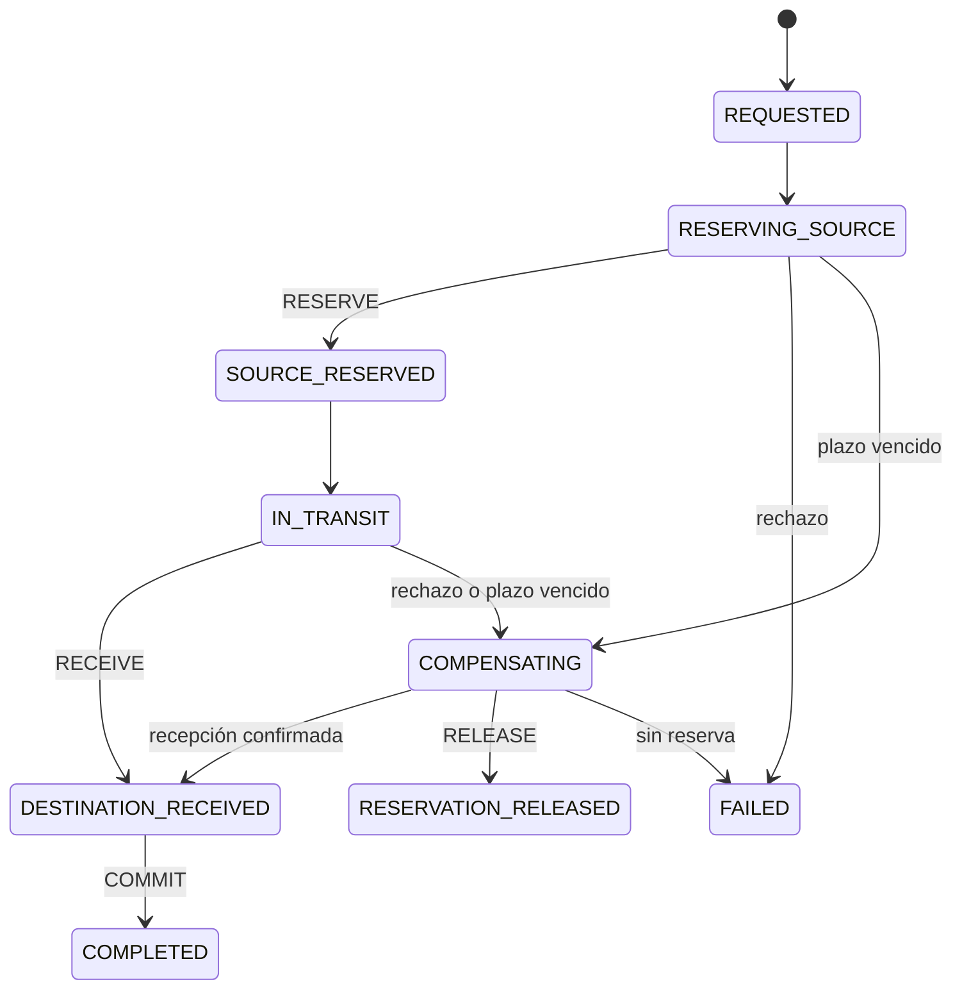

# Fase 6 · Saga y reportes con Athena

La Central orquesta las transferencias y las bodegas conservan sus bases operativas. El outbox central entrega los comandos y el outbox de bodega devuelve los resultados por el forwarder de la fase 7. Cada bodega registra el paso y sus efectos en una sola transacción.

Si el destino no responde, el origen mantiene la reserva hasta que el destino confirme si ya recibió. `CANCEL_RECEIVE` impide una recepción tardía cuando aún no hubo entrada. `RELEASE` devuelve el saldo al disponible y registra una marca aunque no hubiera reserva. Si falla el despacho tras una recepción confirmada, el historial conserva el motivo y el estado queda en `DESTINATION_RECEIVED`.

## Demostración y actualización

Para volúmenes existentes, aplicar con `psql -v ON_ERROR_STOP=1` las migraciones 002 y 003 en la Central y 004 en cada bodega antes de iniciar los contenedores de esta versión. Los scripts están disponibles dentro de los contenedores PostgreSQL en `/db/migrations`. Los volúmenes nuevos se inicializan con los esquemas completos.

Iniciar el entorno con `./manage_warehouse.sh start all` o `./manage.ps1 start all`. Cargar un SKU con 100 unidades en WH-001 y 20 en WH-002. Solicitar 30 en el tablero `http://localhost:8090/dashboard` y revisar el historial. El criterio de aceptación es `COMPLETED`, 70 disponibles y 0 reservadas en origen, y 50 disponibles en destino. La prueba automatizada requiere `SECOND_WAREHOUSE_URL=http://localhost:8002`.

El exportador escribe movimientos, transferencias terminales y fotos de inventario como JSONL por día. En local usa el volumen `central_exports`. El endpoint `/reports/athena/export-status` muestra el avance. Athena necesita Glue y un workgroup configurado por Terraform. Sin configuración, iniciar una consulta devuelve `503`. El acceso por CLI se hace con `python scripts/athena_report.py --list`.

Para ensayar un rechazo simulado desde el tablero, configura `SAGA_ALLOW_SIMULATION=true` en el entorno de la Central. El plazo se puede ajustar entre 5 y 3.600 segundos. Deja desactivado el modo de simulación en instalaciones compartidas.

## Verificación

Pasaron las 52 pruebas de `tests/unit` y `tests/central`. Entre ellas se comprobó que, ante un timeout, una confirmación tardía de recepción conduce al despacho, que un fallo de almacenamiento permite reintentar la exportación y que la API reúne todas las páginas de Athena. Compose validó la configuración de la Central y las bodegas. También pasaron `terraform fmt -check -recursive` y `terraform validate`. La prueba de Athena usa un cliente simulado. El despliegue real en AWS queda para el commit 6.
