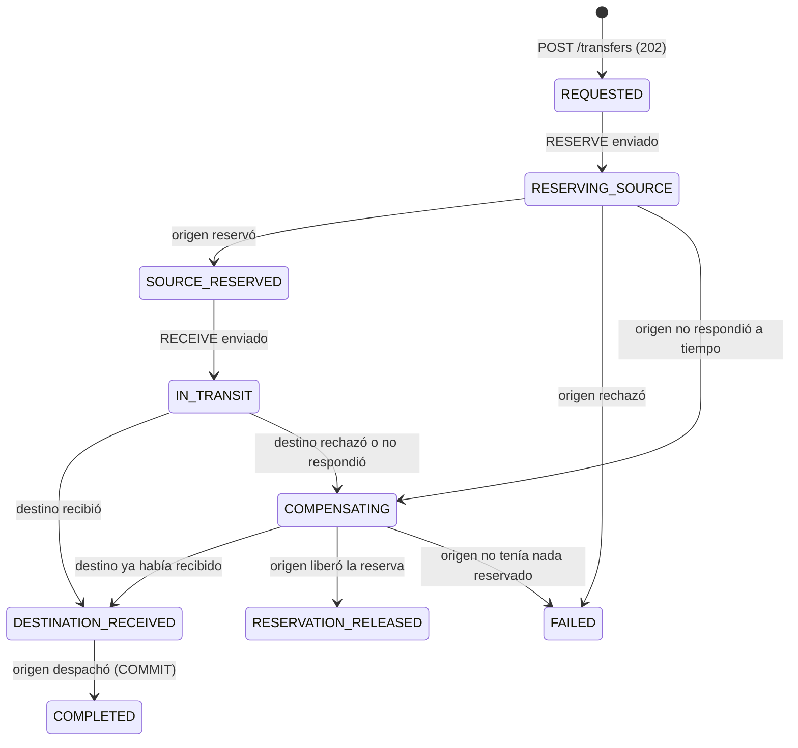

# Fase 6: transferencias entre bodegas con una Saga

## Objetivo

Transferir unidades entre dos bodegas (caso de la guía: P-001 con WH-001 = 100 y WH-002 = 20,
transferir 30 → WH-001 = 70 y WH-002 = 50) sin una transacción SQL entre sus bases, usando una
**Saga orquestada** por la central con compensaciones.

## Cómo funciona

```text
cliente -- POST /transfers --> CENTRAL (orquestador)  -> 202 {"transfer_id": "TR-000001", "status": "PROCESSING"}
                                  |  transfers + transfer_history + transfer_commands (outbox de comandos)
                    central_command_relay --> RabbitMQ central: commands.WH-001 / commands.WH-002
                                                         |
                                             command_worker de cada bodega
                          (una transacción local: movimiento + transfer_operations + respuesta en su outbox)
                                                         |
                                 relay -> forwarder -> central.events -> cola central.saga -> central_saga
```

- La central decide el siguiente paso y cuándo compensar; las bodegas solo ejecutan pasos.
- Los comandos se guardan en un outbox de la central y las respuestas en el outbox de cada bodega,
  así que ninguno se pierde si algo se cae (viajan por el camino sin pérdida de la Fase 7).
- Hay una cola de comandos por bodega: si WH-002 está caída, sus comandos la esperan.

| Paso | Bodega | Movimiento | Compensación |
|---|---|---|---|
| `RESERVE` | origen | `RESERVATION` (disponible → reservado) | `RELEASE` |
| `RECEIVE` | destino | `TRANSFER_IN` (si no tiene el producto, lo crea) | `CANCEL_RECEIVE` |
| `COMMIT` | origen | `TRANSFER_OUT` desde lo reservado | — |

Las unidades quedan **reservadas** en el origen durante la transferencia: no se pueden vender dos
veces y compensar es solo liberarlas. El origen despacha solo cuando el destino confirmó.

```text
             WH-001 disp.  WH-001 reserv.  WH-002 disp.
inicio           100            0             20
RESERVE           70           30             20
RECEIVE           70           30             50
COMMIT            70            0             50   -> COMPLETED
```

## Diagrama de estados



### Compensaciones

1. **El origen rechaza** (sin stock, SKU inexistente) → `FAILED`. No hay nada que deshacer.
2. **El destino rechaza** → `COMPENSATING` → `RELEASE` al origen → `RESERVATION_RELEASED`.
3. **El origen no responde a tiempo** → `RELEASE` al origen. Es seguro aunque no haya reservado:
   deja una marca y un `RESERVE` atrasado se rechaza.
4. **El destino no responde a tiempo** → la central le pide `CANCEL_RECEIVE` y **espera su
   respuesta** antes de liberar (no compensa a ciegas, porque el destino pudo haber recibido):
   - "no recibí nada" → `RELEASE` al origen → `RESERVATION_RELEASED`;
   - "ya lo había recibido" → sigue con `COMMIT` → `COMPLETED`.

Cada paso tiene un plazo (`SAGA_STEP_TIMEOUT_SECONDS`, 60 s por defecto) y una bodega rechaza un
comando vencido.

### Idempotencia

- En la bodega, `transfer_operations` tiene `(transfer_id, paso)` único: un comando repetido no se
  ejecuta dos veces.
- En la central, `transfer_history.event_id` es único: una respuesta repetida se ignora, y cada
  respuesta solo vale en ciertos estados.

## Experimentos de la guía

| Experimento | Resultado |
|---|---|
| Camino feliz (30 de WH-001 a WH-002) | `REQUESTED → … → COMPLETED`; WH-001 = 70, WH-002 = 50 |
| 1. Fallar antes de reservar (pedir 1000) | `FAILED` por stock insuficiente; nada cambió |
| 2. Fallar después de reservar (`simulate_failure: DESTINATION_REJECTS`) | `COMPENSATING → RESERVATION_RELEASED`; WH-001 siguió en 70 |
| 3. Destino caído (WH-002 apagada, plazo 8 s) | Quedó en `COMPENSATING` con 10 unidades reservadas; al encender WH-002: `CANCEL_RECEIVE` y `RESERVATION_RELEASED` |
| 4. Mensaje duplicado (mismo `RESERVE` 3 veces) | WH-001 reservó una sola vez |
| 5. Timeout (command_worker de WH-002 detenido) | `COMPENSATING` al vencer el plazo; el `RECEIVE` vencido se rechazó al volver |
| 6. Worker reiniciado (`central_saga` apagado) | Las respuestas esperaron en `central.saga` y la transferencia terminó `COMPLETED` |

Al final WH-001 + WH-002 sumaban lo mismo que al principio. Cada experimento se puede repetir desde el
tablero (`/dashboard`, sección Transferencias, con plazo y falla simulada) y `docker stop/start`.

## Orquestación vs coreografía

Elegimos orquestación: la lógica está en un solo lugar (`central/saga.py`), se ve el estado con
`GET /transfers/{id}` y las bodegas no se conocen entre sí. La desventaja es que depende de la
central, pero si se cae no se pierde nada: todo queda en colas y outbox (experimento 6).

## Cómo usarlo

```http
POST http://localhost:8090/transfers
Content-Type: application/json

{"sku": "P-001", "source_warehouse_id": "WH-001", "destination_warehouse_id": "WH-002", "quantity": 30}
```

`GET /transfers/{id}` muestra el historial paso a paso y `GET /transfer-operations` en cada bodega
lo que hizo en cada paso. Nuevos contenedores: `central_saga`, `central_command_relay` y el
`command_worker` de cada bodega.

## Preguntas de la guía

**¿Por qué no una transacción distribuida (2PC)?** Bloquea las dos bases mientras decide y exige que
todas las bodegas estén arriba a la vez, lo contrario de la autonomía de la Fase 4.

**¿Qué es una compensación?** Una acción que deshace el efecto de un paso ya confirmado (`RELEASE`
deshace `RESERVE`). No es un rollback: el paso sí ocurrió y queda en el historial.

**¿Qué consistencia hay?** Eventual: durante unos segundos las unidades están reservadas "en
tránsito", pero al final origen + destino suman lo mismo que al principio.
